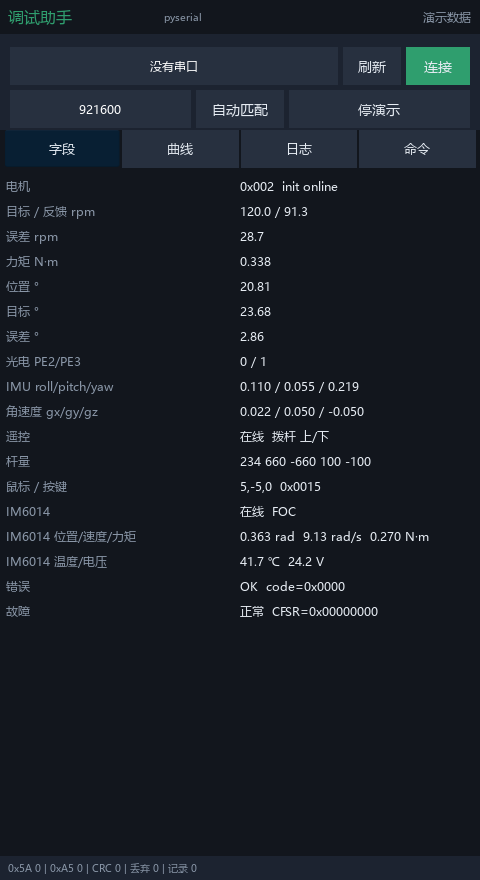
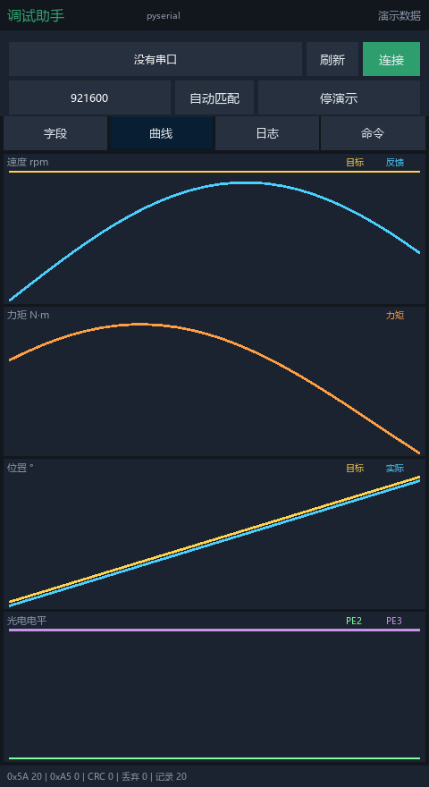

# 调试助手 · Android

Kivy 版,手机/平板用 **USB-OTG 线直连** CH340 / CP2102 / FT232 / PL2303 / CDC ACM,
不需要电脑。协议和桌面版**同源**——`proto.py` 是从桌面版 `调试助手.py` 自动抽取的,
不是另写一份(见「协议同步」)。




## 目录

```text
android/
├── main.py                 Kivy 界面(字段 / 曲线 / 日志 / 命令 四页)
├── proto.py                ★ 自动生成:协议解析 + 记录导出(来自桌面版)
├── serial_link.py          串口:Android 用 usb4a/usbserial4a,桌面预览用 pyserial
├── demo.py                 演示数据源(没硬件也能看界面)
├── buildozer.spec          打 APK 的配置
├── manifest/               USB Host 声明 / OTG 插入 intent / 设备过滤
├── tools/sync_proto.py     从桌面版生成 proto.py(改协议只改桌面版)
├── tests/test_proto.py     校验 proto.py 与桌面版解析结果一致
├── tests/test_packaging.py 校验 buildozer.spec / manifest / 导出文件
├── tests/smoke_ui.py       桌面跑一遍界面并截图(开发用)
└── requirements.txt        桌面预览要装的包
```

## 桌面先跑一遍

```bash
python -m pip install -r requirements.txt
python main.py            # 桌面预览:列 COMx / ttyUSB* 串口(需要 pyserial)
python main.py --demo     # 没硬件:合成 0x5A 帧,四个页面都能看
```

`--demo` 也可以用界面上的「演示」按钮随时开关。

## 打 APK

**buildozer 只能在 Linux 上跑**(Windows 用 WSL2 的 Ubuntu 22.04 或一台 Ubuntu 机器)。首次构建会下载
Android SDK/NDK(数 GB),之后增量很快。

```bash
# Ubuntu 22.04(WSL2 同理)
sudo apt update
sudo apt install -y python3-pip python3-venv git zip unzip openjdk-17-jdk \
     autoconf libtool pkg-config zlib1g-dev libncurses-dev cmake libffi-dev libssl-dev
python3 -m pip install --user buildozer cython

cd android
buildozer -v android debug          # 产物:bin/tiaoshizhushou-0.1.0-*-debug.apk
adb install -r bin/tiaoshizhushou-0.1.0-*-arm64-v8a-debug.apk
```

只打 arm64(现在手机基本都是 arm64,能少一半构建时间):

```bash
buildozer -v android debug --arch arm64
```

改完代码重新打包前不需要 `clean`;改了 `buildozer.spec` 或依赖才需要
`buildozer android clean`。

## 真机使用

1. 手机要支持 **USB Host**(绝大多数安卓机都有,有些平板没有);
2. 用 **OTG 转接头/线**把 CH340 之类插到手机上;
3. 打开 App → 「刷新」→ 选中出现的串口 → 「连接」;
4. **第一次会弹「允许访问 USB 设备」,必须点允许**,否则会提示没拿到 USB 权限;
5. 波特率:CH340 最高 **921600**,`4000000` 只有 CDC ACM(USB 直连的板子)才可能跑得动;
6. 不知道波特率就点「自动匹配」(依次试 921600 / 115200 / 100000 / 4000000,收到有效帧即停)。

串口上同时有二进制帧和 `[LOG]` 文本时,和桌面版一样会自动分开:文本进「日志」页,
`0x5A` / `0xA5` 帧进「字段」「曲线」页。

## 页面

| 页面 | 内容 |
|---|---|
| 字段 | 电机 PID、位置/目标/误差、IMU、遥控、IM6014、错误/故障码 |
| 曲线 | 速度(目标/反馈)、力矩、位置(目标/实际)、光电 PE2/PE3 |
| 日志 | 收到的 `[LOG]` 文本 + 操作记录；「记录 / 暂停显示 / 导出」都在这里 |
| 命令 | 原始 HEX 发送；0x5C 速度 / 角度 / PID 六路 / 回读 / 停止 |

导出文件在:

```text
Android: /sdcard/Download/调试助手/(不可写时退到应用私有目录,日志里会打印真实路径)
桌面预览: android/导出/
```

## 协议同步(重要)

`proto.py` 是**生成文件**,不要手改:

```bash
cd android
python tools/sync_proto.py          # 重新生成 + 冒烟(解码 + 导出)
python tools/sync_proto.py --check  # 只检查是否最新
python tests/test_proto.py          # 逐字段比对桌面版与 android 版的解析结果
python tests/test_packaging.py      # 打包配置 / manifest / 导出文件
python tests/smoke_ui.py            # 用演示数据跑界面并截图(需要图形环境)
```

改协议 → 改桌面版 `调试助手.py` → 跑一次 `sync_proto.py`,两端永远一致。
`test_proto.py` 用 60/84/148 B 的 0x5A 帧、0xA5 帧、夹杂噪声和半帧的字节流做对比。

## 和桌面版的差别

有:0x5A 遥测(电机/IMU/遥控/IM6014)、0xA5 上位机帧、记录导出、0x5C 命令、
自动匹配波特率、演示模式。

暂时没有:多端口同时收(手机一般就插一个)、电机调试/舵轮/VOFA 三个子窗口(改成上面的四页)、
背景图(桌面版专属)、`[LOG] PID` 文本自动回填 PID 输入框。

## 常见问题

- **列表里没有串口**:OTG 线是不是只供电?换一根;手机开发者选项里看 USB 配置是否「USB 主机」。
- **连接后没数据**:波特率不对(点自动匹配);TX/RX 没交叉;固件没开 `Debug_Send_*`。
- **一插就闪退**:看 `adb logcat | findstr python`(Windows)或 `adb logcat | grep python`。
- **中文显示成方块**:手机系统字体里没有 Noto CJK(极少见),可在 `main.py` 的 `CJK_FONTS`
  里加一行你机器上的字体路径。
